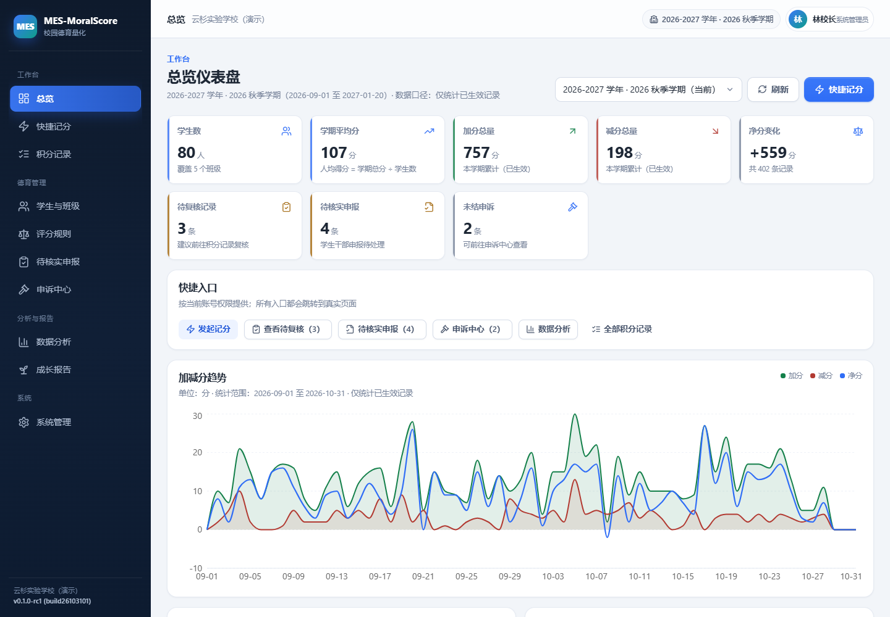
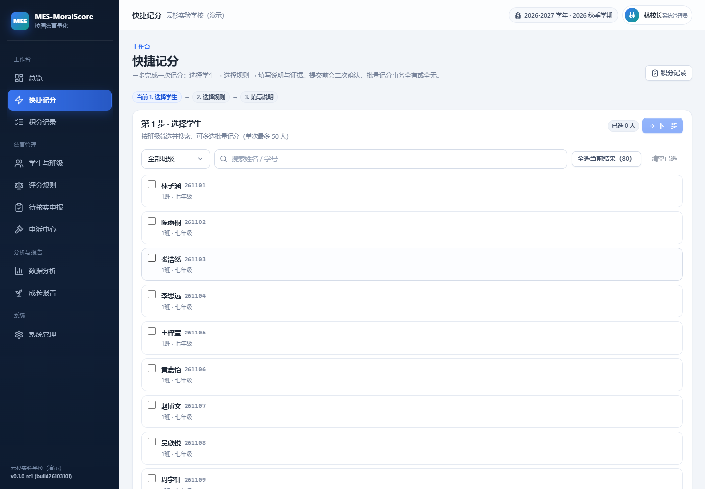
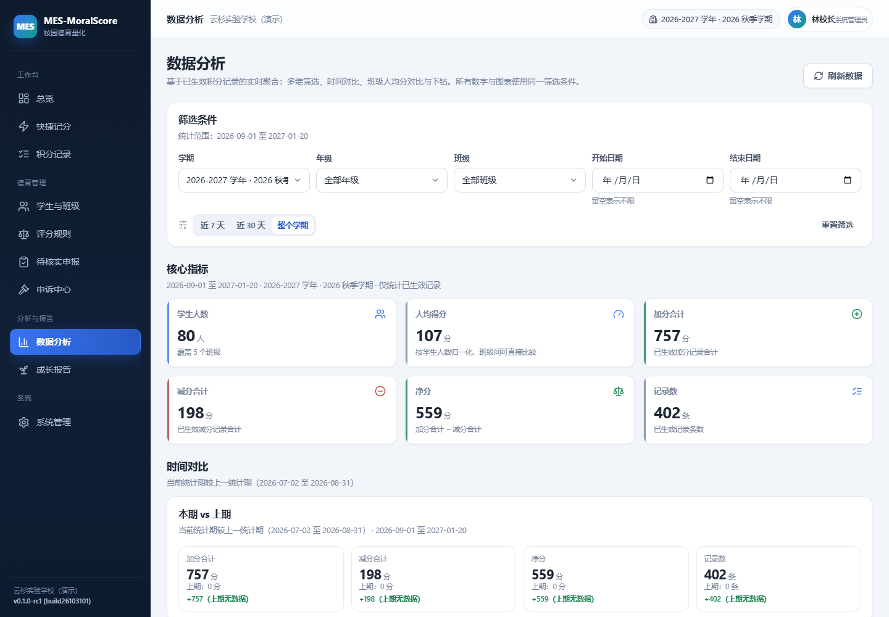
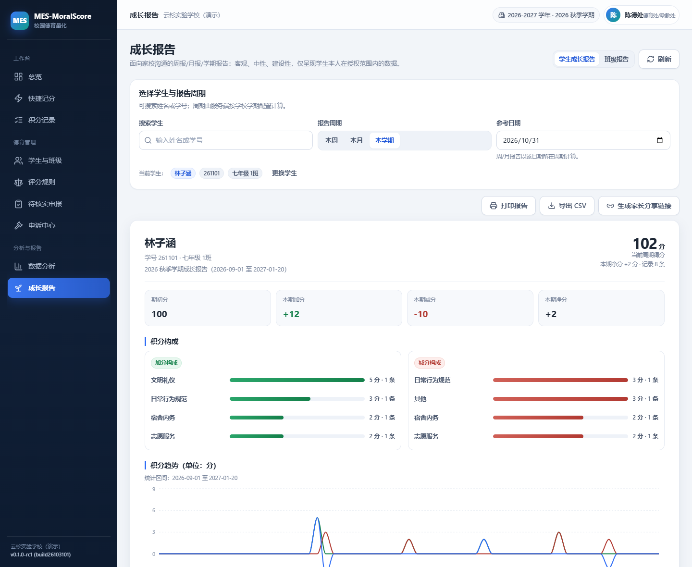
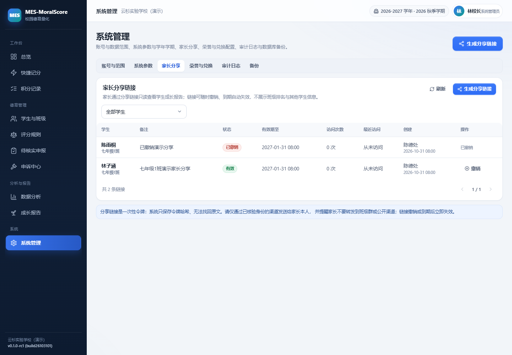
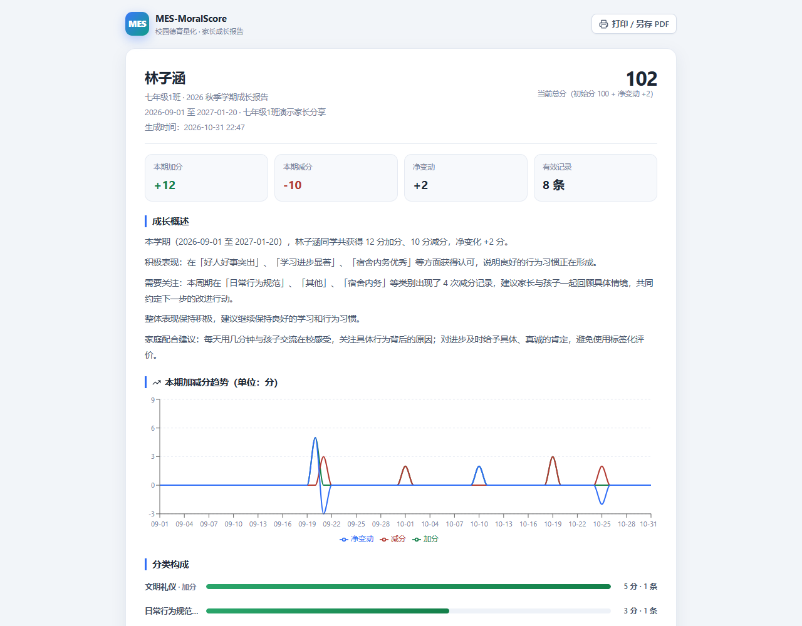

# MES-MoralScore · School Moral-Education Scoring

[](https://github.com/turtlelnc/MES-MoralScore/releases)
[](https://github.com/turtlelnc/MES-MoralScore/releases)
[](LICENSE)
[](https://github.com/deepseek-ai/deepseek-harness)

**v0.1.0-rc1** (build26103101) ｜ MIT License

English | [中文](README.md)

MES-MoralScore is a full-stack Node.js web application for Chinese K-12 schools to turn everyday moral-education behaviour into transparent, explainable and traceable records. It supports rule versioning, an append-only points ledger, student-cadre submissions with teacher verification, appeals with documented decisions, growth reports, read-only parent shares, batch CSV import, analytics, real backups and append-only audit logs.

> Scores are process-management references for positive encouragement — not a judgement of a student's character.

## Screenshots

| Dashboard | Quick scoring |
| --- | --- |
|  |  |

| Analytics | Student growth report |
| --- | --- |
|  |  |

| Parent share management | Public parent report |
| --- | --- |
|  |  |

## Highlights

- **Three fixed roles**: SYSTEM_ADMIN, MORAL_AFFAIRS (moral-education office), DUTY_TEACHER with server-enforced RBAC and class/grade data scopes.
- **Versioned scoring rules**: DRAFT → SUBMITTED → APPROVED → PUBLISHED → ARCHIVED; published versions are immutable and every record stores a rule snapshot.
- **Immutable ledger**: integer points, effective records cannot be updated/deleted (database triggers); corrections use reversal/correction entries with linked history.
- **Mobile-first quick scoring**: batch selection, evidence upload, confirmation step, automatic moral-office review for high-impact records.
- **Student-cadre submissions**: revocable/expiring class links, student number + name verification, always pending review — never directly changes points.
- **Appeals**: reasoned decisions, conflict-of-interest flag when the decision maker submitted the original record, accepted appeals resolved through reversal/correction.
- **Analytics & growth reports**: real SQL aggregations, per-student average class comparison, weekly/monthly/term reports with neutral narrative, honors and reward references.
- **Read-only parent share**: high-entropy token (hash stored), expiry, revocation, access log; never exposes class ranking or other students.
- **Operations**: CSV import with preview/error rows/transactional commit, CSV exports with formula-injection protection, real SQLite backups, append-only audit logs.

## Tech stack

Node.js ≥ 24, Express 5, `node:sqlite` (`DatabaseSync`), React 19, TypeScript, Vite 6, Tailwind CSS 4, recharts, Vitest, Playwright. SQLite was chosen (consistent with the MES-Homework architecture) so the app runs on a school server with no external database service; the service layer is portable to PostgreSQL.

## Quick start

```bash
npm install
npm run seed:demo          # fictional demo school
npm start                  # http://127.0.0.1:8080
```

Demo accounts: `admin / Admin@MES2026`, `moral / Moral@MES2026`, `teacher1 / Teacher@MES2026`.
Demo share link: `/#/share/demo-parent-share-2026`; submission link: `/#/submit/demo-cadre-link-2026`.

Production: `npm run build`, `npm run admin:create -- --account=admin --password='...'`, set `APP_SECRET`, HTTPS and `COOKIE_SECURE=1` — see [docs/DEPLOYMENT.md](docs/DEPLOYMENT.md).

## Verification

```bash
npm test
npm run build
npm run test:browser
```

## Docs

- [Architecture contract](docs/ARCHITECTURE.md)
- [Deployment](docs/DEPLOYMENT.md)
- [Security & privacy](docs/SECURITY.md)
- [AGENTS.md](AGENTS.md)

## License

[MIT](LICENSE) © 2026 turtlelnc

Built and verified with [DeepSeek Harness](https://github.com/deepseek-ai/deepseek-harness).

[](https://github.com/deepseek-ai/deepseek-harness)
