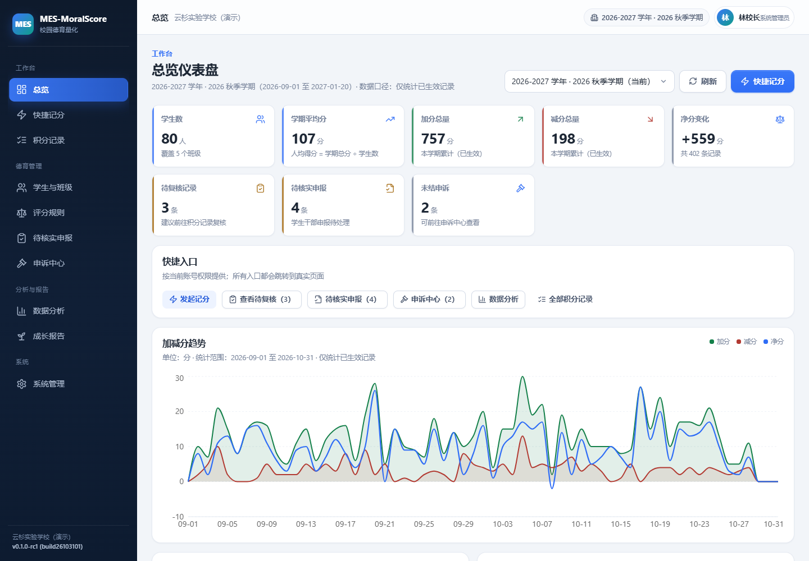
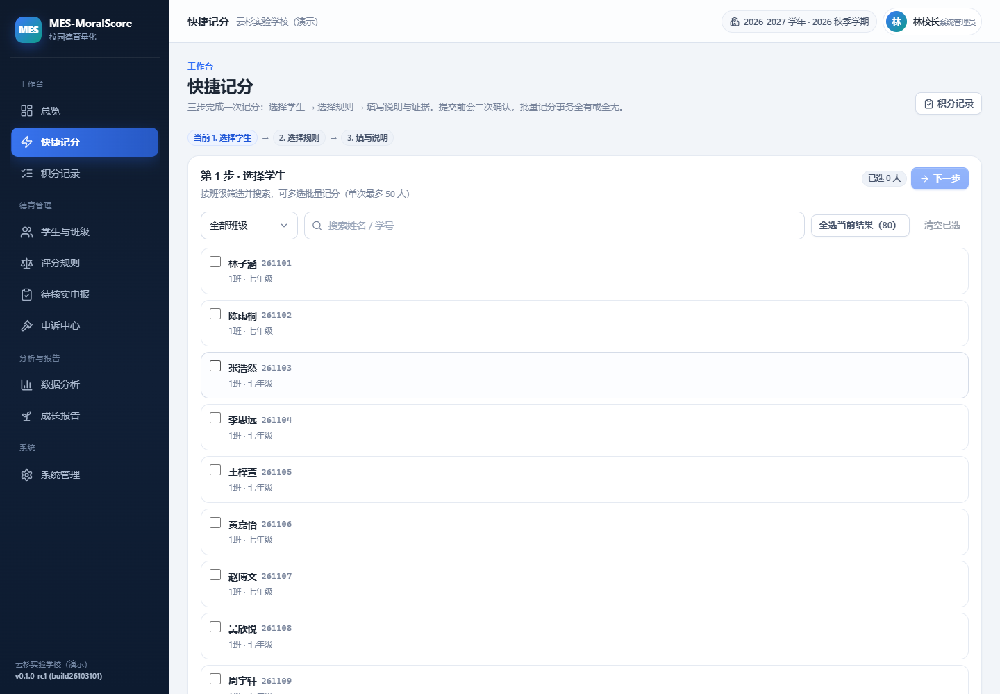
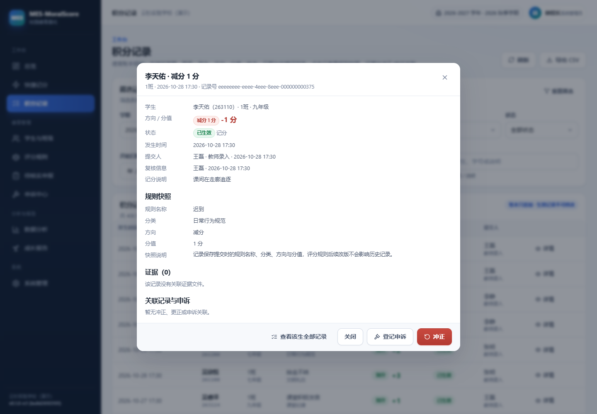
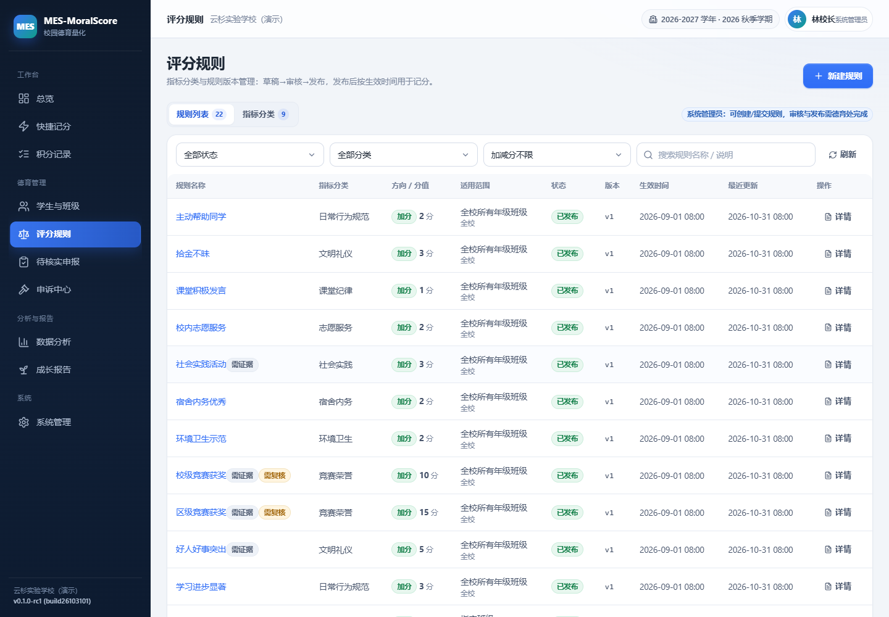
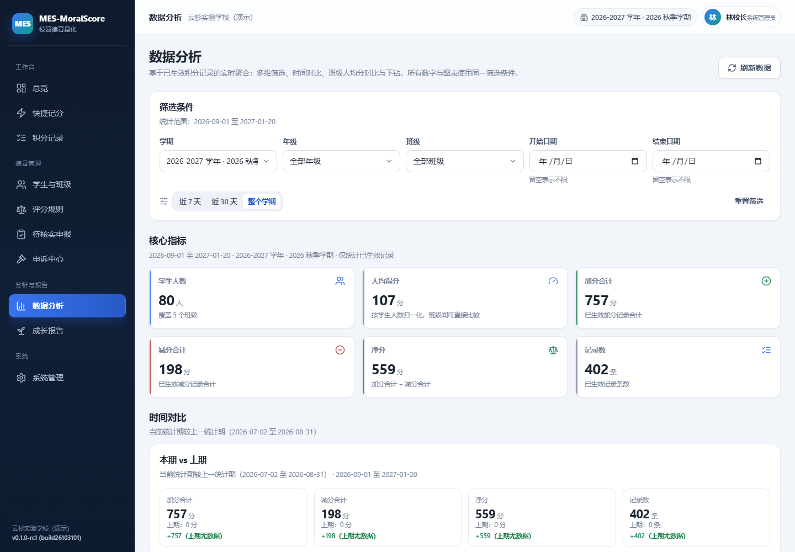
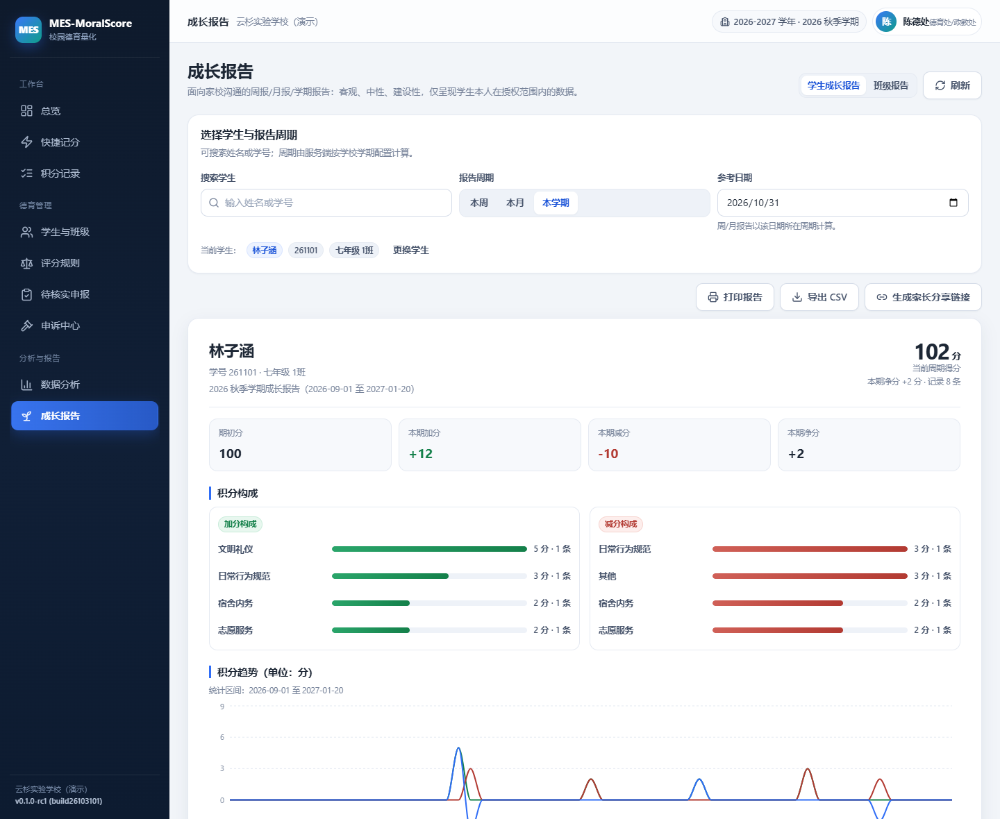
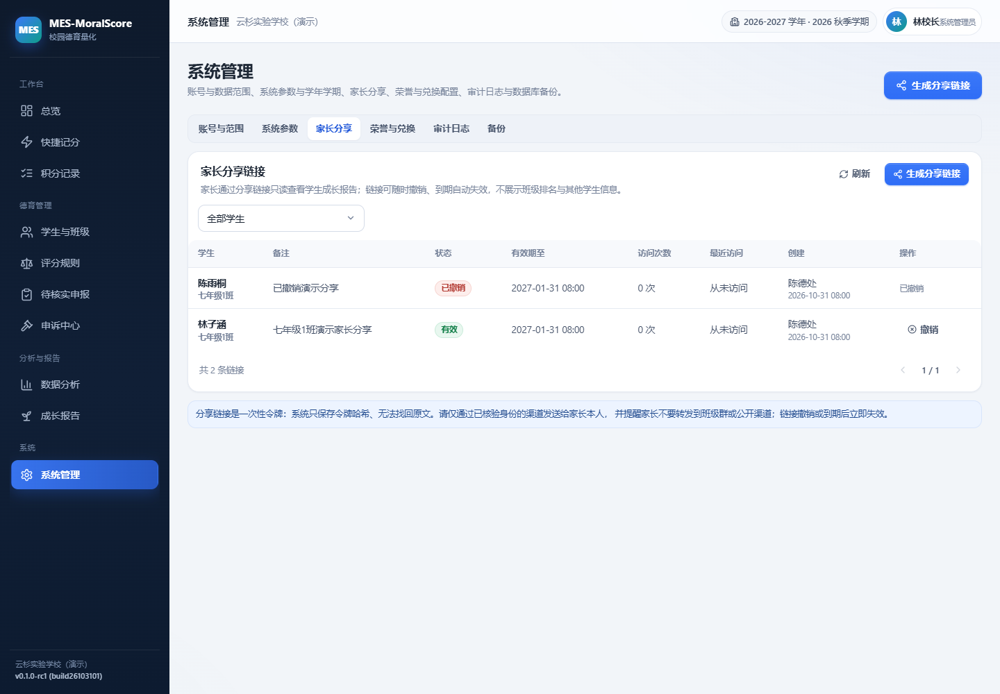
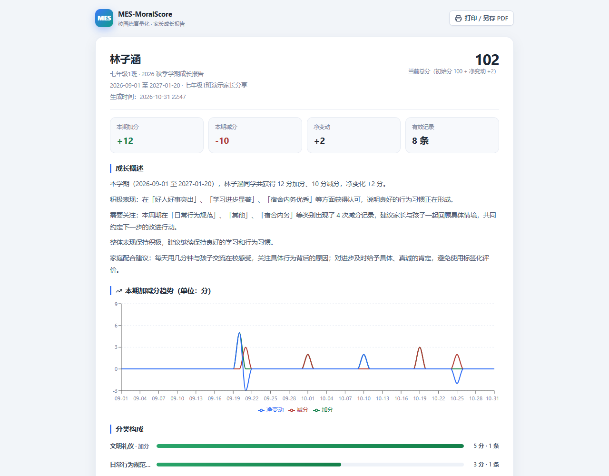
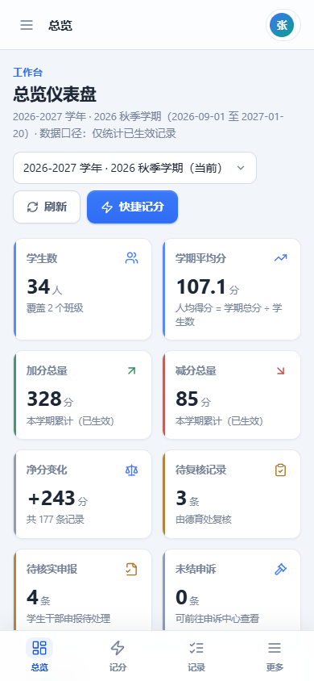
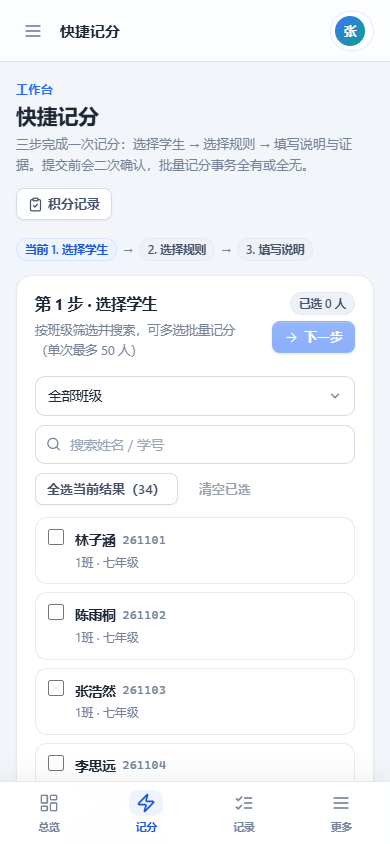

# 校园德育量化 · MES-MoralScore

[](https://github.com/turtlelnc/MES-MoralScore/releases)
[](https://github.com/turtlelnc/MES-MoralScore/releases)
[](https://github.com/turtlelnc/MES-MoralScore/actions)
[](LICENSE)
[](docs/SECURITY.md)
[](#响应式与多端体验)
[](package.json)
[](https://github.com/deepseek-ai/deepseek-harness)

**v0.1.0-rc1**（build26103101）｜ MIT License

[English](README.EN.md) | 中文

MES-MoralScore（校园德育量化）是面向中小学校德育处/政教处、系统管理员和值日老师的 Node.js 全栈 Web 应用：把日常行为规范、课堂纪律、宿舍内务、社会实践、竞赛荣誉等德育表现，转化为**透明、可解释、可追溯**的量化记录，降低人工统计成本，帮助学校做过程管理与正向激励。

> 产品价值是“公平、透明、及时、可追溯、重激励”，不是用单一分数给学生贴标签。系统分数不得作为对学生人格或品德的绝对判断，也不替代学校依法依规的教育评价程序。

---

## 界面预览

| 总览仪表盘 | 快捷记分（三步完成） |
| --- | --- |
|  |  |

| 积分记录与账本详情 | 评分规则版本管理 |
| --- | --- |
|  |  |

| 数据分析 | 学生成长报告 |
| --- | --- |
|  |  |

| 家长分享管理 | 家长只读报告（公开链接） |
| --- | --- |
|  |  |

| 手机端总览 | 手机端快捷记分 |
| --- | --- |
|  |  |

---

## 功能总览

### 1. 三类核心角色与数据范围

| 角色 | 能做什么 |
| --- | --- |
| **系统管理员**（SYSTEM_ADMIN） | 学校资料、学年学期、年级班级、学生教师、账号与数据范围、批量导入、备份与审计；可维护指标分类与规则草稿，但**不能绕过德育处发布评分标准** |
| **德育处/政教处**（MORAL_AFFAIRS） | 审核/发布/归档评分标准、全校数据看板、积分复核、撤销冲正、申诉受理与裁决、报表导出、家长分享链接 |
| **值日老师**（DUTY_TEACHER） | 仅在授权的年级/班级范围内快捷记分、学生干部申报初审、查看学生档案与积分、登记申诉；不能改规则、不能看授权范围外数据、不能裁决申诉 |

权限由服务端在每个接口强制校验（角色 + 数据范围），不是前端隐藏按钮；越权返回 403/404，错误信息不泄露其他班级学生信息。

### 2. 规则版本与发布流程

- 生命周期：`DRAFT → SUBMITTED → APPROVED → PUBLISHED → ARCHIVED`（驳回可回到草稿）。
- 已发布规则**不可静默覆盖**：修改必须生成新版本；数据库触发器禁止改写已审核/已发布版本内容。
- 每条记录保存写入时的 `rule_snapshot_json`（规则名、分类、方向、分值、版本、说明），后续改版不影响历史记录。
- 记分只接受当前有效、范围匹配（全校/年级/班级）的已发布版本。

### 3. 积分账本（不可篡改）

- 每个学生按学年/学期分别统计：`学期得分 = 初始分 + Σ已生效加分 - Σ已生效减分`，分值全部使用整数。
- 待复核、已驳回记录不计分；`EFFECTIVE` 记录在数据库层禁止 UPDATE/DELETE。
- 错误只能通过**冲正（REVERSAL）**与**更正（CORRECTION）**追加记录处理，原记录、操作者、原因、关联记录全部保留；同一记录仅允许一条生效冲正。
- 初始分、是否允许负分、复核阈值均可配置。

### 4. 快捷记分与复核

- 移动端优先：选择学生（支持班级筛选、搜索、批量多选）→ 选择规则 → 填写说明/证据 → 二次确认 → 提交。
- 批量记分事务化，全有或全无；返回逐条结果与待复核提示。
- 规则要求复核、分值达到复核阈值（默认 ≥10 分）或特殊荣誉时自动进入德育处复核队列；复核通过/驳回必须填写理由并留痕。
- 证据文件私有存储、随机文件名、类型白名单、授权下载。

### 5. 学生干部申报（待核实，不直接改分）

- 教师/德育处为班级生成**可撤销、可过期、可统计使用次数**的申报链接（库中只存 token 哈希）。
- 学生通过“学号 + 姓名”校验提交表现申报；错误信息不区分学号不存在或姓名不匹配。
- 申报一律进入 `PENDING_REVIEW`，**不产生积分**；值日老师核实通过并选择已发布规则后才生成正式积分记录，驳回/要求补充必须填理由。

### 6. 申诉中心

- 只能对已生效记录发起；同一记录同时仅允许一个未结申诉。
- `SUBMITTED → UNDER_REVIEW → ACCEPTED / REJECTED`；裁决理由必填。
- 裁决人与原记录提交人相同时记录利益冲突（`conflict_flag`）并要求填写例外说明，写入只追加的 `appeal_decisions`。
- 接受申诉通过**冲正**或**冲正 + 更正**处理账本，不直接改写原记录。

### 7. 数据分析与成长报告

- 总览仪表盘：周期 KPI、加分/减分趋势、班级人均分对比、年级分布、分类构成、异常提醒、待办队列，全部来自真实数据库聚合。
- 多维分析：学校/年级/班级/学生，时间范围与本期/上期对比、规则排行、分类归因，指标可下钻到明细。
- 学生成长报告（周报/月报/学期报告）：积分构成、趋势、亮点表现、需要关注的行为类别（中性措辞）、规则解释、荣誉与兑换参考、确定性生成的中性叙述；支持打印与 CSV 导出。
- 班级对比使用**人均得分 + 学生数**口径，避免不同人数班级只比总分。

### 8. 家长只读分享

- 德育处/管理员为学生生成高熵分享链接：token 只存哈希，支持过期（1–90 天）、撤销、访问日志与访问次数统计。
- 家长打开链接只能看到该学生的成长报告，**不展示班级排名、其他学生信息或后台功能**；过期/撤销统一返回无效提示。
- 部署前必须通过学校已有家校渠道核验家长身份后再发放链接（见 [docs/SECURITY.md](docs/SECURITY.md)）。

### 9. 批量导入、导出、备份与审计

- 学生/班级/教师 CSV 导入：先预览（必填、班级关联、重复学号、文件内重复、编码）→ 错误行明细 → 事务提交，失败不产生半批脏数据；可下载错误明细与模板。
- 列表/报表按当前筛选条件导出 CSV（UTF-8 BOM），导出范围受操作者数据权限限制，并做公式注入防护。
- 备份为真实 SQLite `VACUUM INTO`：可 CLI 定时执行，也可在系统管理中手动触发并查看真实状态、文件大小与错误；未配置备份目录时明确报错，不伪造成功。
- 关键操作（登录、规则发布、记分、冲正/更正、复核、申诉裁决、账号与范围变更、导入、备份、分享创建/撤销、证据上传等）写入只追加的审计日志。

### 10. 响应式与多端体验

- 手机（360px 起）：底部主导航 + 抽屉菜单、卡片化列表、移动端弹窗为底部抽屉、快捷记分少量步骤完成。
- 平板：双列布局与可触达筛选区；电脑：侧边栏 + 顶部栏 + 多列卡片/图表/数据表。
- 全站无整页横向溢出；表单具备必填提示、服务端校验错误、提交中状态、成功/失败反馈与防重复提交。
- 高影响操作（撤销、批量记分、规则发布、申诉裁决、账号停用、备份）均二次确认并展示影响范围。

---

## 技术栈与架构

- **运行时**：Node.js ≥ 24（ESM），无需额外数据库服务。
- **后端**：Express 5 + `node:sqlite`（`DatabaseSync`），模块化服务层（roster/rules/scoring/submissions/appeals/analytics/reports/share/admin/imports/backup）。
- **前端**：React 19 + TypeScript + Vite 6 + Tailwind CSS 4 + lucide-react + recharts。
- **认证**：HttpOnly + SameSite=Lax 会话 Cookie，scrypt 密码哈希，登录失败限流，改密后吊销其他会话。
- **测试**：Vitest（服务端单元/集成）+ Playwright（真实浏览器桌面与手机流程）。
- **迁移**：`server/schema.sql` 幂等建表 + `server/migrations.mjs` 版本化迁移；`npm run seed:demo` 提供虚构演示数据。

**为什么用 SQLite 而不是 PostgreSQL？** 本项目参考 MES-Homework 的架构约定，面向学校单机/校内服务器部署，SQLite + 私有文件目录可以零外部依赖启动，备份即复制单个数据库文件，符合“干净环境按 README 即可运行”的交付要求。服务层与 SQL 均参数化，数据模型可平移到 PostgreSQL；若未来多校区/高并发部署，建议迁移到 PostgreSQL 并保持 API 不变（见 [已知限制](#已知限制与后续计划)）。

## 快速开始（本地）

```bash
# 1. 安装依赖（Node.js 24+）
npm install

# 2. 载入演示数据（虚构的“云杉实验学校”，可重复执行；--force 重播）
npm run seed:demo

# 3. 启动服务（默认 http://127.0.0.1:8080）
npm start
# 或开发模式：前后端分离热更新
npm run dev:server   # 终端 1，监听 8080
npm run dev          # 终端 2，Vite 页面 http://127.0.0.1:5173（/api 代理到 8080）

# 4. 生产构建 + 由 Express 托管 dist
npm run build
npm start
```

打开 `http://127.0.0.1:8080`，使用演示账号登录：

| 角色 | 账号 | 密码 |
| --- | --- | --- |
| 系统管理员 | `admin` | `Admin@MES2026` |
| 德育处/政教处 | `moral` | `Moral@MES2026` |
| 值日老师（七年级） | `teacher1` | `Teacher@MES2026` |
| 值日老师（八年级） | `teacher2` | `Teacher@MES2026` |
| 值日老师（九年级） | `teacher3` | `Teacher@MES2026` |

演示链接（仅演示数据）：

- 家长只读报告：`http://127.0.0.1:8080/#/share/demo-parent-share-2026`
- 学生干部申报：`http://127.0.0.1:8080/#/submit/demo-cadre-link-2026`（七年级1班）

> 所有演示数据均为虚构；请勿把演示账号用于正式部署。生产环境请用 `npm run admin:create` 创建首个管理员，并通过导入/系统管理维护真实数据。

## 生产部署（摘要）

完整说明见 [docs/DEPLOYMENT.md](docs/DEPLOYMENT.md)。

```bash
npm ci
npm run build
# 创建管理员（密码至少 10 位且含字母与数字；首次登录会提示改密）
npm run admin:create -- --account=admin --password='YourStrongPass1' --name=林校长 \
  --school-name=某某实验学校 --school-code=MY-SCHOOL --stage=初中

# 配置 .env（至少 APP_SECRET；HTTPS 部署设置 COOKIE_SECURE=1）
cp .env.example .env
node --env-file=.env server/index.mjs
```

- 反向代理（Nginx/Caddy）需转发 `/api` 与静态资源，并设置 `APP_ORIGIN=https://你的域名`、HTTPS、`COOKIE_SECURE=1`。
- 数据目录 `DATA_DIR`（默认 `./data`）包含 SQLite 数据库与私有证据文件，**不要**放进公开静态目录；定期用 `npm run backup:run` 备份到独立磁盘。
- 局域网服务器版：`HOST=0.0.0.0` 并放行端口；仅本机使用保持 `HOST=127.0.0.1`。

## 测试与验证

```bash
npm test                 # Vitest：权限/范围隔离、账本不可改与冲正、规则版本、申报审核、申诉、报告聚合、导入、备份等
npm run build            # tsc -b + vite build（严格类型检查）
npm run test:browser     # Playwright 真实浏览器流程（桌面 1440 + 手机 390，需 Chromium）
```

CI（GitHub Actions，见 `.github/workflows/cloud-validation.yml`）在 Ubuntu 与 Windows 上运行 `npm ci`、`npm test`、`npm run build`，Ubuntu 额外安装 Chromium 并执行 `npm run test:browser`，上传失败截图/trace。

## 权限矩阵

| 能力 | 系统管理员 | 德育处 | 值日老师 |
| --- | --- | --- | --- |
| 学校资料/学年学期/年级班级/学生/教师 | ✅ | 只读 | 只读（授权范围） |
| 账号与数据范围管理 | ✅ | ❌ | ❌ |
| 指标分类维护 | ✅ | 只读 | 只读 |
| 规则草稿创建/编辑/提交 | ✅ | ✅ | ❌ |
| 规则审核/发布/驳回/归档 | ❌（不可绕过德育处） | ✅ | ❌ |
| 日常记分 | ✅ | ✅ | ✅（授权范围） |
| 待复核记录审批/驳回 | ✅ | ✅ | ❌ |
| 撤销/冲正/更正账本 | ✅ | ✅ | ❌ |
| 学生干部申报初审 | ✅ | ✅ | ✅（授权范围） |
| 申诉登记 | ✅ | ✅ | ✅（授权范围） |
| 申诉裁决 | ❌ | ✅ | ❌ |
| 全校/年级/班级分析 | ✅ | ✅ | 授权范围 |
| 家长分享链接 | ✅ | ✅ | ❌ |
| 批量导入 | ✅ | ❌ | ❌ |
| 备份/审计日志 | ✅ | ❌ | ❌ |
| 成长报告 | ✅ | ✅ | 授权范围 |

## 数据模型摘要

`School`、`AcademicYear`/`Term`、`Grade`/`Class`、`Student`、`Teacher`、`User`/`Role`/`UserScope`、`ScoringCategory`、`ScoringRule`/`ScoringRuleVersion`、`ScoreRecord`（账本，含冲正/更正关联）、`StudentSubmission`（干部申报）、`SubmissionToken`、`Appeal`/`AppealDecision`、`ParentShare`/`ParentShareAccessLog`、`ImportJob`/`ImportError`、`AuditLog`、`BackupJob`、`EvidenceFile`、`HonorRule`/`RewardItem`、`SystemSetting`。外键、唯一约束、索引与性能相关索引见 [server/schema.sql](server/schema.sql)；不可篡改规则由数据库触发器兜底。

## 安全与隐私

本项目处理未成年人信息，默认最小化采集、最小权限与隐私保护：服务端鉴权与数据范围校验、防 IDOR、密码安全哈希、登录限流、同源写入校验、安全响应头与 CSP、私有证据存储与授权下载、分享 token 哈希存储与撤销、审计日志只追加、导出/备份权限控制。详见 [docs/SECURITY.md](docs/SECURITY.md)。

**部署前必须完成**：配置高强度 `APP_SECRET`、启用 HTTPS 与安全 Cookie、核验家长身份后再发放分享链接、设置数据备份与访问权限、按学校制度告知师生与家长数据处理规则。

## 目录结构

```text
server/            Express 5 + node:sqlite 服务端（app.mjs 工厂、index.mjs 启动、领域模块与 Vitest）
src/               React 19 前端（main.tsx 外壳、pages/ 页面、components/ui.tsx 设计系统）
tools/             运维工具（备份 CLI、管理员初始化）
tests/browser/     Playwright 真实浏览器流程与隔离 fixture 服务
docs/              架构协作契约、部署、安全、截图
data/              运行期数据目录（SQLite + 私有证据，已 gitignore）
.github/workflows/ CI
```

## 已知限制与后续计划

- **未做 AI 自动评分/评语生成**：本版本所有积分与报告均由规则和真实记录确定性计算，避免用生成式模型直接给学生下判断；后续如需 AI 辅助，只应作为教师解释与建议，不自动改分。
- **家长身份核验依赖学校线下渠道**：分享链接为高熵能力 URL，需学校确认家长身份后发放；后续可接入学校统一身份/短信验证码。
- **SQLite 单机部署**：适合单校/校内服务器；多校区、高并发与大报表场景建议迁移 PostgreSQL 并增加读写分离。
- **学生端账号**：本版本学生通过受限申报链接参与，不开放学生登录；家长通过只读分享查看报告。后续版本可接入统一身份认证。
- **XLSX 导入/导出**：本版本支持 CSV（Excel 可直接打开 UTF-8 BOM CSV）；XLSX 作为后续增强。
- **通知渠道**：申诉/申报结果目前通过站内状态与页面反馈，未接入短信/企业微信通知。

## 许可

[MIT License](LICENSE) © 2026 turtlelnc

---

本项目在 [DeepSeek Harness](https://github.com/deepseek-ai/deepseek-harness) 协作下完成研发与验证。

[](https://github.com/deepseek-ai/deepseek-harness)
